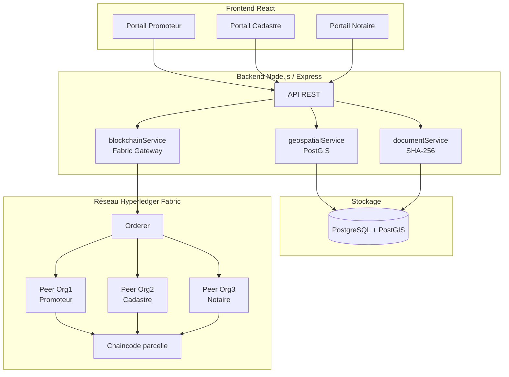

# 🏛️ FoncierSûr

**Plateforme SaaS de traçabilité foncière sécurisée par blockchain, pour le Sénégal.**

FoncierSûr numérise le cycle de vie d'un dossier foncier — de la soumission par le promoteur jusqu'à la certification notariale — en s'appuyant sur **Hyperledger Fabric** pour garantir un registre infalsifiable des étapes de validation, et sur **PostGIS** pour détecter automatiquement les chevauchements et anomalies géométriques.

> ⚠️ FoncierSûr n'est pas un système d'enregistrement légal. C'est un outil de **traçabilité et de preuve** : la blockchain n'enregistre jamais de données personnelles ou de titres de propriété eux-mêmes, seulement l'historique immuable des décisions prises sur un dossier.

---

## 📐 Architecture



**Flux métier** : le Promoteur soumet une parcelle (géométrie + document) → contrôles PostGIS automatiques (validité, superficie, chevauchement) → transaction Fabric `SubmitParcel` → le Cadastre valide techniquement (`ValidateByCadastre`) → le Notaire certifie juridiquement (`CertifyByNotaire`). Chaque transition d'état est enregistrée de façon immuable sur le ledger Fabric.

| Rôle métier | Organisation Fabric | Responsabilité |
|---|---|---|
| Promoteur | `Org1MSP` | Soumet le dossier (géométrie, document) |
| Cadastre | `Org2MSP` | Valide la conformité technique |
| Notaire | `Org3MSP` | Certifie juridiquement et clôture le dossier |

---

## 🧰 Prérequis

| Outil | Version recommandée | Vérifier avec |
|---|---|---|
| [Docker Desktop](https://www.docker.com/products/docker-desktop/) | 24.x ou plus récent | `docker --version` |
| [Node.js](https://nodejs.org/) | 20.x LTS | `node --version` |
| [Git](https://git-scm.com/) | toute version récente | `git --version` |
| WSL2 (si Windows) | Ubuntu 22.04+ | `wsl --version` |

> 💡 Le réseau blockchain télécharge automatiquement les images Docker Hyperledger Fabric (~2 Go) au premier lancement — prévoyez une connexion correcte pour cette étape unique.

---

## 🚀 Démarrage en 5 minutes

### 1. Cloner le projet

```bash
git clone https://github.com/LadyNdiaye/FoncierSur.git
cd FoncierSur
```

### 2. Démarrer le réseau blockchain (Hyperledger Fabric)

```bash
cd blockchain/fabric-network/test-network
export PATH=${PWD}/../bin:$PATH
export FABRIC_CFG_PATH=${PWD}/../config/
./network.sh up createChannel -c fonciersur-channel -ca
./addOrg3/addOrg3.sh up -c fonciersur-channel
```

### 3. Déployer le chaincode

```bash
./network.sh deployCC -ccn parcelle -ccp ../../chaincode/parcelle -ccl typescript -c fonciersur-channel -ccv 1.0 -ccs 1
```

> Le script `deployCC` installe et approuve automatiquement pour Org1 et Org2 seulement. Approuvez ensuite le chaincode pour Org3 (Notaire) en suivant [l'installation manuelle sur Org3](#-réseau-blockchain--commandes-détaillées).

### 4. Démarrer la base de données et le backend

```bash
cd ../../..
docker compose up -d
cd backend
cp .env.example .env
npm install
node src/scripts/seed.js
npm start
```

Variables principales du fichier `backend/.env` :

| Variable | Rôle |
|---|---|
| `DB_HOST`, `DB_PORT`, `DB_NAME`, `DB_USER`, `DB_PASSWORD` | Connexion PostgreSQL/PostGIS |
| `JWT_SECRET`, `JWT_EXPIRES_IN` | Authentification |
| `FABRIC_CHANNEL`, `FABRIC_CHAINCODE` | Canal et chaincode (`fonciersur-channel`, `parcelle`) |
| `FABRIC_NETWORK_PATH` | Chemin du `test-network` (certificats des 3 organisations) |
| `USE_MOCK_BLOCKCHAIN` | `false` pour utiliser le vrai réseau Fabric |

Le script `seed.js` crée les comptes `promoteur@fonciersur.sn`, `cadastre@fonciersur.sn` et `notaire@fonciersur.sn`.

### 5. Démarrer le frontend

```bash
cd ../frontend
npm install
npm run dev
```

### 6. Ouvrir l'application

| Portail | URL |
|---|---|
| Application (Vite) | http://localhost:5173 |
| API Backend | http://localhost:5000/api |

---

## 📸 Aperçu des 3 portails

### Espace Promoteur
_(dessin du polygone sur la carte, upload du document, suivi du dossier)_


### Espace Cadastre
_(liste des dossiers soumis, visualisation des chevauchements, validation technique)_


### Espace Notaire
_(certification finale, historique des transactions blockchain, vérification d'intégrité)_


> 📁 Placez vos captures d'écran dans `docs/screenshots/` sous ces noms exacts pour qu'elles s'affichent automatiquement ici.

---

## 🎥 Vidéo de démonstration

▶️ **[Voir la démo complète du workflow (Soumission → Validation → Certification)](https://youtu.be/aR6Rf2Mb618)**

---

## 🗂️ Structure du projet

---

## ⛓️ Réseau blockchain — commandes détaillées

### Mapping organisations ↔ rôles métier

| Organisation Fabric | Rôle métier | Port peer |
|---|---|---|
| `Org1MSP` | Promoteur | `localhost:7051` |
| `Org2MSP` | Cadastre | `localhost:9051` |
| `Org3MSP` | Notaire | `localhost:11051` |

> Le réseau utilise le **test-network officiel** de `fabric-samples`, avec **Fabric CA** pour la génération des identités.

### Fonctions du chaincode

| Fonction | Organisation | Statut résultant |
|---|---|---|
| `SubmitParcel(parcelId, reference, docHash, userId)` | Org1 (Promoteur) | `SOUMISE` |
| `ValidateByCadastre(parcelId, userId, status, comment)` | Org2 (Cadastre) | `VALIDE_CADASTRE` ou `REJETE_CADASTRE` |
| `CertifyByNotaire(parcelId, userId, comment)` | Org3 (Notaire) | `CERTIFIEE` |
| `RejectByNotaire(parcelId, userId, comment)` | Org3 (Notaire) | `REJETE_NOTAIRE` |
| `QueryParcel(parcelId)` | tous | lecture |
| `GetParcelHistory(parcelId)` | tous | historique des transactions |
| `VerifyDocument(parcelId, providedHash)` | tous | `true` / `false` |

Chaque transition enregistre l'identité de l'organisation et le `userId` dans l'historique. La chaîne de validation est stricte (Cadastre puis Notaire) et une parcelle certifiée n'est plus modifiable.

### Installer le chaincode manuellement sur Org3 (Notaire)

Le script `deployCC` ne couvre qu'Org1 et Org2. Après l'avoir lancé :

```bash
cd blockchain/fabric-network/test-network
export PATH=${PWD}/../bin:$PATH
export FABRIC_CFG_PATH=${PWD}/../config/
export ORDERER_CA=${PWD}/organizations/ordererOrganizations/example.com/tlsca/tlsca.example.com-cert.pem

export CORE_PEER_TLS_ENABLED=true
export CORE_PEER_LOCALMSPID="Org3MSP"
export CORE_PEER_TLS_ROOTCERT_FILE=${PWD}/organizations/peerOrganizations/org3.example.com/peers/peer0.org3.example.com/tls/ca.crt
export CORE_PEER_MSPCONFIGPATH=${PWD}/organizations/peerOrganizations/org3.example.com/users/Admin@org3.example.com/msp
export CORE_PEER_ADDRESS=localhost:11051

peer lifecycle chaincode install parcelle.tar.gz

# Récupérer le PACKAGE_ID (parcelle_<version>:<empreinte>) :
peer lifecycle chaincode queryinstalled

peer lifecycle chaincode approveformyorg \
  -o localhost:7050 --ordererTLSHostnameOverride orderer.example.com \
  --tls --cafile "$ORDERER_CA" \
  --channelID fonciersur-channel --name parcelle --version 1.0 \
  --package-id <PACKAGE_ID> --sequence 1

peer lifecycle chaincode querycommitted --channelID fonciersur-channel --name parcelle
```

Résultat attendu : `Approvals: [Org1MSP: true, Org2MSP: true, Org3MSP: true]`.

### Mettre à jour le chaincode après une modification

Lire la version et la séquence actuelles avec `querycommitted` (commande ci-dessus), puis déployer avec une version nouvelle et une séquence **augmentée de 1** :

```bash
./network.sh deployCC -ccn parcelle -ccp ../../chaincode/parcelle -ccl typescript -c fonciersur-channel -ccv 1.1 -ccs 2
```

Répéter ensuite la procédure Org3 ci-dessus avec la même version, la même séquence et le nouveau `PACKAGE_ID`.

### Vérifier que la blockchain fonctionne

Test de bout en bout depuis le backend (workflow complet, rejets, refus par rôle, historique, intégrité du hash) :

```bash
cd backend
npm run test:blockchain
```

Démonstration en ligne de commande, avec l'identité du Promoteur (Org1) :

```bash
cd blockchain/fabric-network/test-network
export CORE_PEER_TLS_ENABLED=true
export CORE_PEER_LOCALMSPID="Org1MSP"
export CORE_PEER_TLS_ROOTCERT_FILE=${PWD}/organizations/peerOrganizations/org1.example.com/peers/peer0.org1.example.com/tls/ca.crt
export CORE_PEER_MSPCONFIGPATH=${PWD}/organizations/peerOrganizations/org1.example.com/users/Admin@org1.example.com/msp
export CORE_PEER_ADDRESS=localhost:7051

peer chaincode invoke -o localhost:7050 --ordererTLSHostnameOverride orderer.example.com \
  --tls --cafile "$ORDERER_CA" \
  -C fonciersur-channel -n parcelle \
  --peerAddresses localhost:7051 --tlsRootCertFiles organizations/peerOrganizations/org1.example.com/tlsca/tlsca.org1.example.com-cert.pem \
  --peerAddresses localhost:9051 --tlsRootCertFiles organizations/peerOrganizations/org2.example.com/tlsca/tlsca.org2.example.com-cert.pem \
  -c '{"function":"SubmitParcel","Args":["test-001","REF-001","hash123","user-001"]}'

peer chaincode query -C fonciersur-channel -n parcelle \
  -c '{"function":"GetParcelHistory","Args":["test-001"]}'
```

### Redémarrer le réseau existant

Après un arrêt de Docker, les conteneurs sont relancés sans perte de données :

```bash
docker start ca_orderer ca_org1 ca_org2 ca_org3 orderer.example.com
docker start peer0.org1.example.com peer0.org2.example.com peer0.org3.example.com
```

### Arrêter et nettoyer le réseau

```bash
cd blockchain/fabric-network/test-network
./network.sh down
```

⚠️ Supprime les volumes (ledgers) — le chaincode devra être redéployé depuis la version 1 après un redémarrage complet.

### Dépannage

| Symptôme | Cause probable | Solution |
|---|---|---|
| `access denied: creator org unknown` | Certificats désynchronisés | `./network.sh down` puis `up` à nouveau |
| `ProposalResponsePayloads do not match` | Code non-déterministe dans le chaincode | Utiliser `ctx.stub.getTxTimestamp()`, jamais l'horloge système |
| `Peer binary and configuration files not found` | `bin/`/`config/` absents | Relancer `install-fabric.sh docker binary` |
| `connection refused` sur `localhost:7051` | Conteneurs arrêtés | Voir « Redémarrer le réseau existant » |
| `requested sequence N is larger than the next available sequence number` | Séquence supérieure à `dernière + 1` | Lire la séquence avec `querycommitted` et utiliser `+1` |

---

## 👥 Équipe

| Membre | Rôle |
|---|---|
| Ndeye Coumba Ndiaye | Lead Blockchain — réseau Fabric, chaincode, Espace Notaire |
| Carla Diatta | Backend Core — authentification, API, Espace Cadastre |
| Mame Ndiaya Gaye | Géospatial — PostGIS, gestion documentaire, Espace Promoteur |

Projet réalisé dans le cadre du Projet de Fin de Formation (PFF), ISEP Diamniadio.

---

## 🧪 Tests

Depuis le dossier `backend` (après `npm install`) :

| Commande | Contenu | Prérequis |
|---|---|---|
| `npm test` | 4 tests du retry (3 tentatives, erreurs réseau uniquement) | aucun |
| `npm run test:fabric` | 12 tests du chaincode : workflow, rejets, sécurité par organisation, `userId`, historique, intégrité du hash | réseau Fabric démarré |
| `npm run test:blockchain` | Scénario de bout en bout, refus par rôle, chaîne stricte | réseau Fabric démarré |
| `npm run test:api` | 62 vérifications de l'API (rôles, PostGIS, upload, workflow de validation) avec Fabric simulé | `docker compose up -d` |
